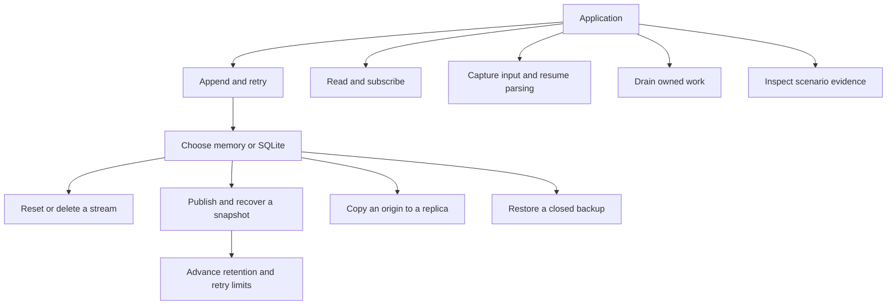

# Keep a history that callers can resume

Event Stream stores immutable events in order. An application chooses each event's
identity, schema and bytes; the library allocates its committed stream position.
For example, a build service can record step results, disconnect a viewer and
resume after its last applied event. The library does not decide what a build
result means or make the application's external side effects exactly once.

Start with [append](append.md) for lost replies, [replay](replay.md) for cursor
boundaries, or [operations](../operations.md) for executable local walkthroughs.
A StreamKey includes a name and an incarnation, the identity of one lifetime.
Reset and controlled restore create new lifetimes; old cursors cannot silently
address replacements. A cursor is a position, not an acknowledgement that your
application applied the record.

No optional features are enabled by default. SQLite, decoding, snapshots,
retention, source journal and replication are explicit capabilities. The
[inventory](inventory.md) maps every family and the separate native verification
console. [Current evidence](verification.md) distinguishes executed tests, finite
models and historical resource measurements. This work preserves the repository's
stability freeze; it does not revive the parked runtime batching prototype.
