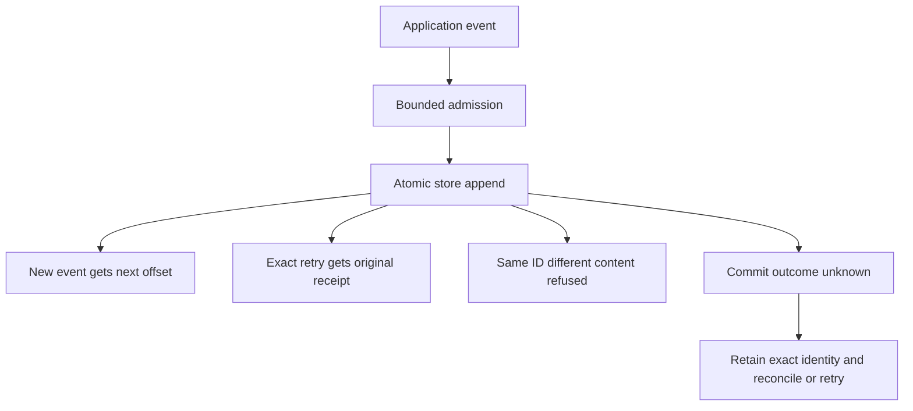

# Record an event once despite a lost reply

Suppose build step 7 emits event `build-7-done`. Keep its ID, schema and exact bytes
until you know the result. Retrying that same event in the same stream lifetime
returns its original record. Reusing the ID with different schema or bytes returns
IdempotencyConflict. A new ID would describe another event and can duplicate work.

## An unknown result still needs reconciliation

Before admission, capacity and timeout can refuse work. Once admitted, the runtime
owns the append even if the caller drops its future. CommitUnknown names the
uncertain event ID. Lookup may resolve committed history internally while the
caller still receives uncertainty; do not infer rollback from an error. Retry
with the original key/ID/schema/bytes under the same retry policy, or inspect
history. Application effects triggered by events need their own idempotency.

`append` may wait within bounded waiter/time limits; `try_append` refuses current
saturation. Event size, queued bytes, request counts, active I/O and per-stream
queues are separate limits. Store CapacityExceeded is different from runtime
Overloaded. Backpressure or a bounded durable source spool belongs to the host;
silent dropping is not a recovery strategy.

Legacy lifetime retries preserve identity for that stream. After explicitly
enabling generational retention, use generated append/lookup with the original
retry generation; expiry intentionally ends that retry promise. See
[retention](retention.md). The store has an append_batch port, but the runtime
still drives individual appends; a grouped store transaction is not cross-stream
atomic application work.

AppendIdentity models two offered payloads for one ID and at most one stored
record. It checks accepted retries preserve content and never allocate a second
offset. It excludes concurrent scheduling, schemas as distinct fields, store
transactions, uncertain replies and generation expiry.
