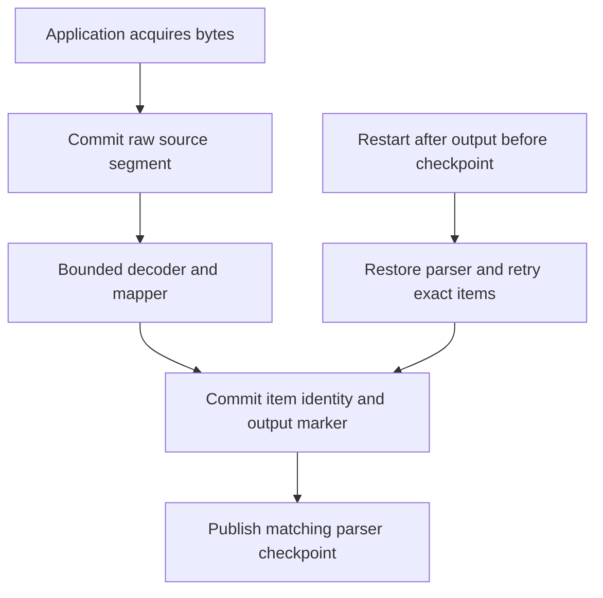

# Resume a parser after output committed but its checkpoint did not

The optional decoder boundary turns input bytes into application events through
EventSink. A normal decoder session is bounded but does not make its source input
durable. Source-journal mode first captures immutable raw segments under a source
identity and parser/output-stream binding. It then appends output with stable item
positions and saves a parser checkpoint describing captured progress and committed
output.

## Never checkpoint ahead of committed evidence

If output item 3 committed but its checkpoint reply was lost, recovery can encounter
item 3 again. Its stable source position/event identity must match the saved output
marker; conflicting output is refused. A checkpoint cannot exceed captured bytes,
claim items not committed, or name a committed-output cursor inconsistent with its
markers. The decoder/mapper must reproduce compatible state and identities; the
library cannot make a changed parser deterministic by itself.

Caller source acquisition and external acknowledgement are outside the store.
Do not acknowledge upstream bytes merely because they entered a transient decoder.
Source sealing fixes an exact end, while parser finalization records that all
remaining decoder output and final checkpoint have completed. These are separate
operations; EOF observation alone is not saved finalization. Retain original
requests for typed uncertain outcomes. Journal cleanup and receipt-floor advance
are bounded explicit operations constrained by recovery state.

JournalCheckpoint models captured bytes 0..2, committed item count 0..2 and an
independently offered checkpoint. It checks saved source progress is captured and
saved item count does not pass committed output. For this small schedule it allows at most one item per captured byte, an
example restriction rather than a production rule. It excludes exact marker/cursor
matching, parser byte semantics, checkpoint monotonicity, generation rotation and
source finalization.
