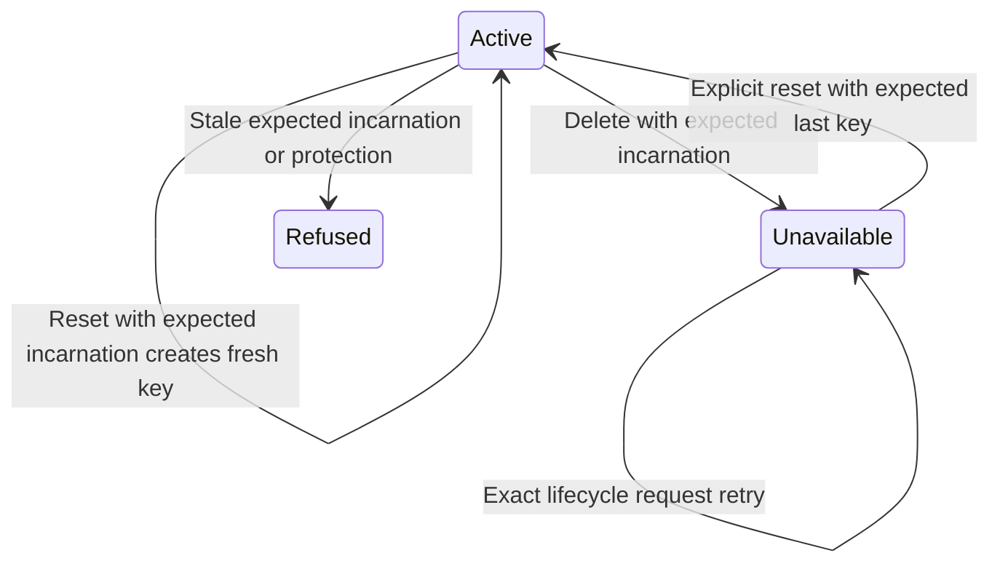

# Replace a stream without accepting its old cursors

Use create_stream when a new name is intended, and find_stream for a noncreating
lookup. A missing name returns None from find; a retired name is unavailable, not
permission to silently create another lifetime. Reset deliberately replaces the
incarnation with an empty history. Delete makes the name unavailable. Both retire
old history for bounded cleanup.

## Retry the operation, then inspect cleanup separately

LifecycleRequest includes an operation ID, expected StreamKey and action. Retain
all three through LifecycleCommitUnknown. An exact retry returns its receipt;
a conflicting reuse of operation ID is refused. The expected incarnation prevents
an old request from deleting a replacement. Required replica protection can refuse
lifecycle changes; do not detach protection casually just to force the operation.

A successful delete/reset changes visibility atomically but does not mean all
retired payload rows are physically reclaimed. Drive cleanup_retired with finite
record/byte limits and inspect remaining. Old metadata and receipt limits can
refuse new work; storage capacity is not released just because a stream disappeared
from the active map. Runtime coordination excludes conflicting same-name work
while a lifecycle operation is owned or uncertain.

LifecycleIdentity models two incarnations and one lifecycle request, with an exact
retry receipt. It checks stale requests cannot modify the current lifetime and
conflicting requests cannot reuse a receipt. It represents the acceptance decision before replacement, with an independent
prior takeover; it does not simulate the new history or retired-row deletion.
Replica policy is excluded.
