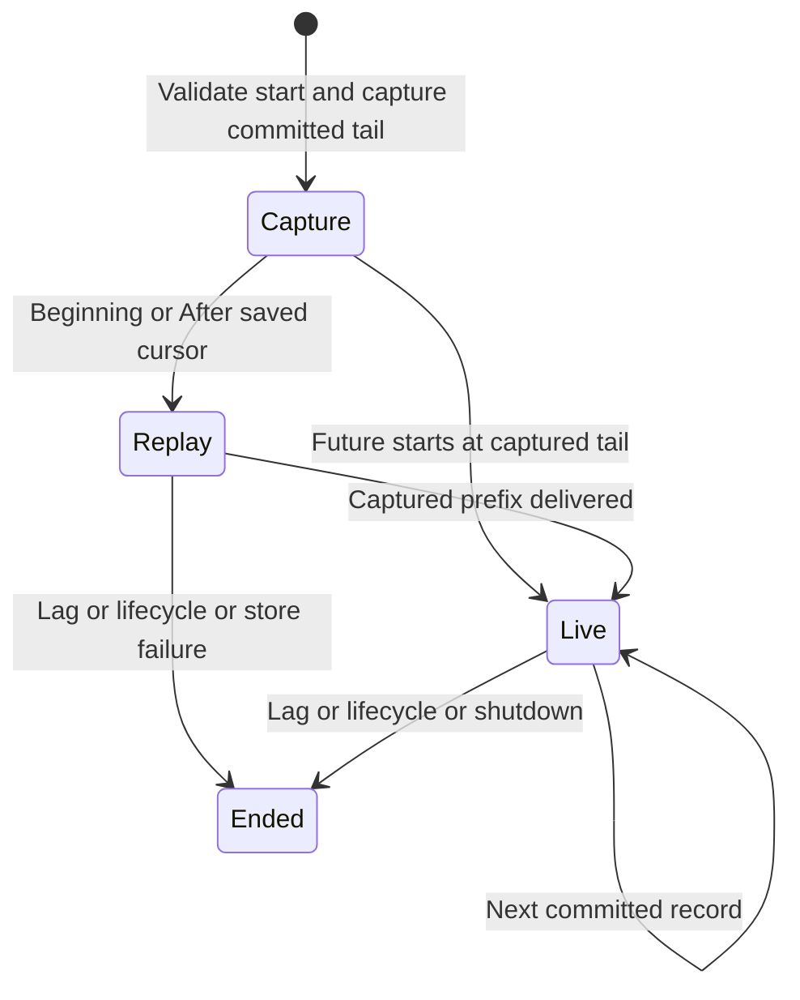

# Resume after the last event your application applied

If your saved cursor is 7 and the captured tail is 10, a range read asks for
`(7, 10]`: records 8, 9, 10, subject to page limits. Cursor 0 means before the first
record. Through equal to after is an empty range; through before after is invalid.
A future cursor is refused. A cursor below the retention floor returns
HistoryUnavailable rather than a silently shortened history.

## Delivery is not application acknowledgement

A subscription captures its replay boundary under the stream's write gate,
registers membership, then reads replay before live history. Future intentionally
skips all records committed at capture. Beginning means the current retained floor,
not necessarily the beginning of all historical time. Save a cursor with your
successfully applied application state; last_delivered only says the library
returned the record. The [projection example](../../examples/projection_reconnect.rs)
demonstrates not advancing application state on a rejected transition.

Cancelling pending next preserves delivery position. Slow subscriptions terminate
with SubscriberLagged and last-delivered/bounds evidence; they do not retain an
unlimited queue. Reconnect from the saved applied cursor if it remains retained,
or use a suitable snapshot recovery plan when old history is unavailable. One
terminal error is delivered, then None. None is not proof the application consumed
all historic events. Reset/delete also invalidate the old lifetime.

Cursor tokens encode version, name, incarnation and a full-width integer offset.
They are validated bounded encodings, not credentials or authorization grants.
Do not round offsets through a JavaScript floating-point number in a transport.

ReplayWindow models after/through/tail0..3 and a retention floor. It checks accepted
ranges never begin below the floor or end beyond captured history. It excludes
payload contiguity, subscription wakeup races, lag clocks and application commits.
