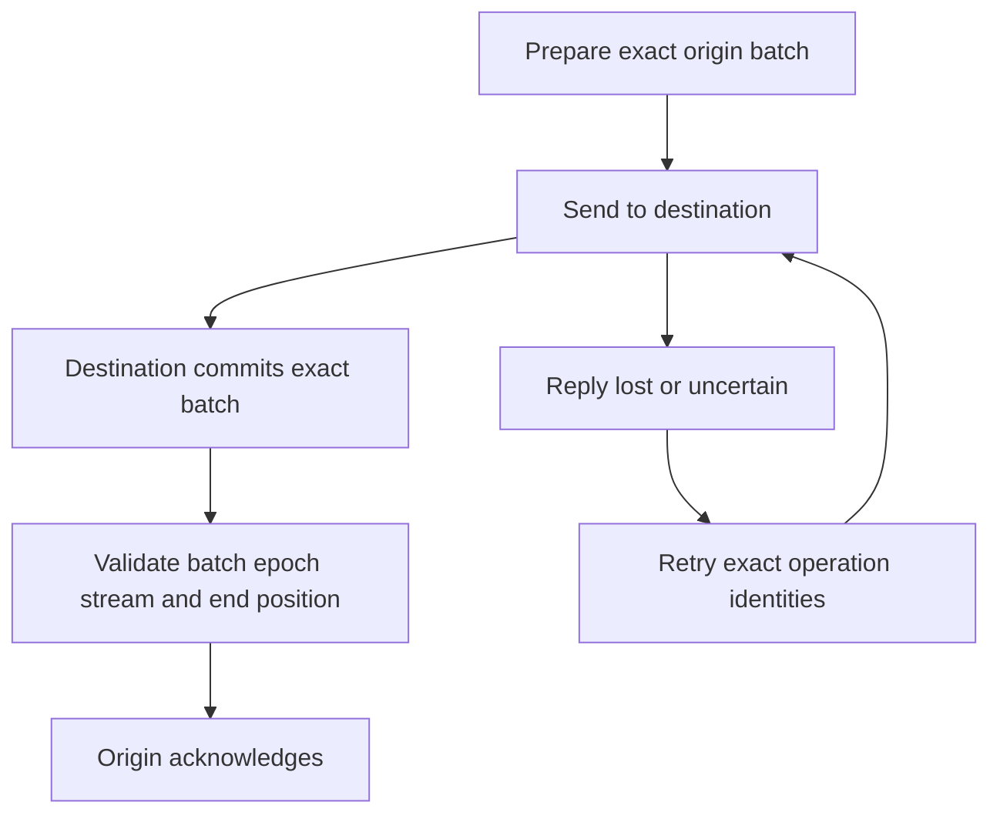

# Catch up a separate durable copy

Attach a replica to one origin stream and drive bounded batches. The origin
prepares exact records; the transport commits them at the destination; a matching
receipt lets the origin advance its acknowledgement and release backlog capacity.
The host owns transport authentication, retry policy and remote availability.
A replica is a copy, not an elected replacement writer.

## A lost reply can leave the copy ahead of its acknowledgement

Do not release origin protection on send or transport success alone. The driver
validates batch ID, destination epoch, stream and exact committed-through position
before acknowledgement. Retain identities through an uncertain send/ack; exact
retry reconciles without inventing a new batch. Required replica backlog can
refuse new appends or retention/lifecycle work. Pause bounded source acquisition,
catch up and retry the rejected event with its original identity.

If a replica lacks a retained prefix, use snapshot-plus-suffix bootstrap rather
than pretend ordinary replay starts at the true beginning. Bootstrap uploads and
verifies data before publication, with separate retry/cleanup ownership. Restoring
an origin rotates identity and detaches old replication state; stale requests
must not silently enter the replacement. Runtime-owned transfer completion does
not close the caller-owned destination; close it only after source shutdown is
resolved. See the [two-store walkthrough](../operations.md).

ReplicaAcknowledgement models one batch, an independently matching or foreign
receipt and a separate destination-commit fact. A valid receipt is generated only after the modeled destination commits; this
is a trusted destination contract, not a second runtime query of its disk. The
model checks origin acknowledgement requires that commit and a matching receipt. Real transport authenticity, epochs,
bytes, bootstrap and failover are outside the abstraction; a malicious transport
is not made trustworthy by a Boolean model.
