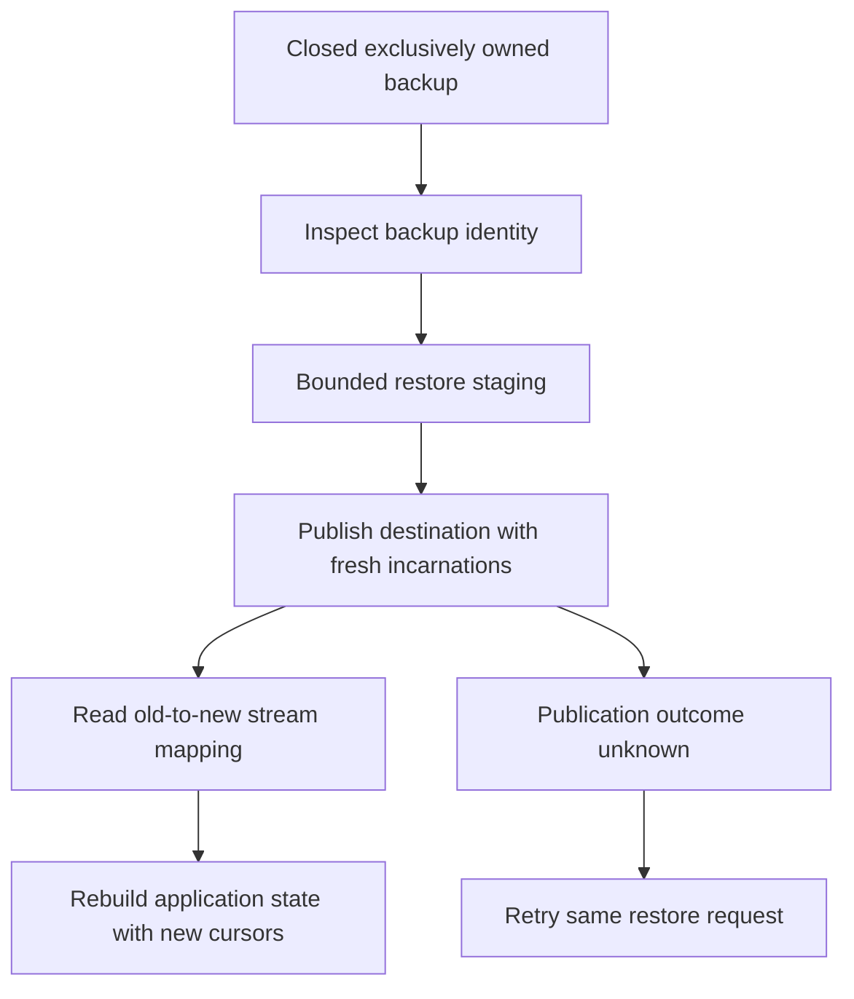

# Restore history without reviving old cursor identities

The local recovery example closes SQLite successfully, exclusively owns its source
directory, copies and flushes the backup, then restores into a new destination.
That copying procedure is not safe for an active database. Online backup needs
coordinated SQLite facilities outside this example.

## Preserve the restore request

RestoreManager bounds admitted operations and owns accepted backend work through
caller cancellation. PublicationUnknown names operation and destination because
publication may already exist. Retry the exact request and inspect its receipt;
do not overwrite a destination or reuse an operation ID for different input.
Incomplete staging and cleanup failure are separate results, not success.

Read the incarnation mapping before rebuilding projections. The library rejects
old cursors against restored streams; it cannot automatically translate an external
application's last-applied checkpoint. Restore also resets origin identity and
replication attachments. Validate application state and re-establish intended
replication explicitly. Backup content identity is an integrity/checkpoint input,
not a grant of authority to read a file.

Current SQLite tests include isolated database and controlled process/fault
schedules. No atlas model proves atomic filesystem publication, real device power
loss, backup trust or arbitrary path replacement. See [evidence](verification.md).
