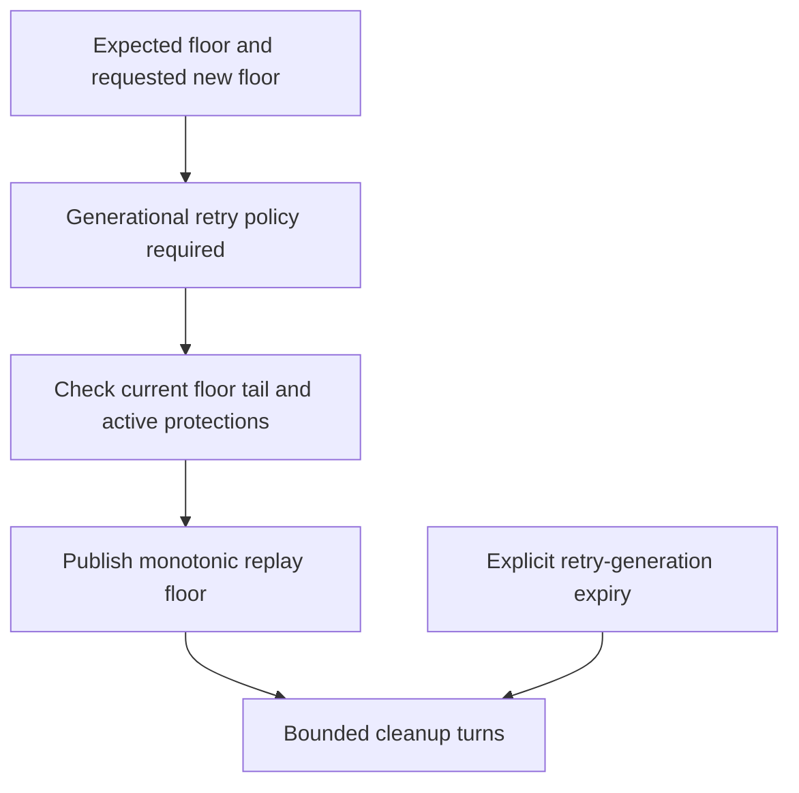

# Advance the replay floor deliberately

With a floor of 7, read_after(7) may return 8 onward; read_after(6) is unavailable.
Moving that floor changes readable history immediately, while bounded cleanup
reclaims old rows later. It does not by itself decide how long exact append retries
must remain accepted. Retry generations make that separate promise explicit.

## Check what still needs the old history

A live recovery lease prevents moving beyond its covered cursor. Required replica
positions can also protect a prefix. Source-journal recovery protects retry
generations needed for output reconciliation. Inspect the typed protection refusal
and complete/release that work through its owner; do not assume a failed floor
advance freed bytes. Expected-floor and expected-generation checks prevent stale
administrative requests from replacing a newer decision.

Once generational retry policy is enabled, use append_generated/lookup_generated
with the original generation. An expired generation is refused, not treated as a
new event. Reusing an ID in a deliberately newer generation is a new identity.
Operation IDs make administrative retries exact; conflicting reuse is rejected.
Cleanup has independent row and byte limits and may retain retry evidence after
replay rows disappear. Report logical floor, accepted retry horizon and reclaimed
bytes separately.

RetentionProtection models floor0..2, tail 2, a recovery protection at 1 and a replica
protection at 0, each independently releasable. It checks an accepted floor never
crosses either active protection at decision time. It excludes clocks, journal
retry-generation protection, SQL cleanup and storage-accounting correctness.
