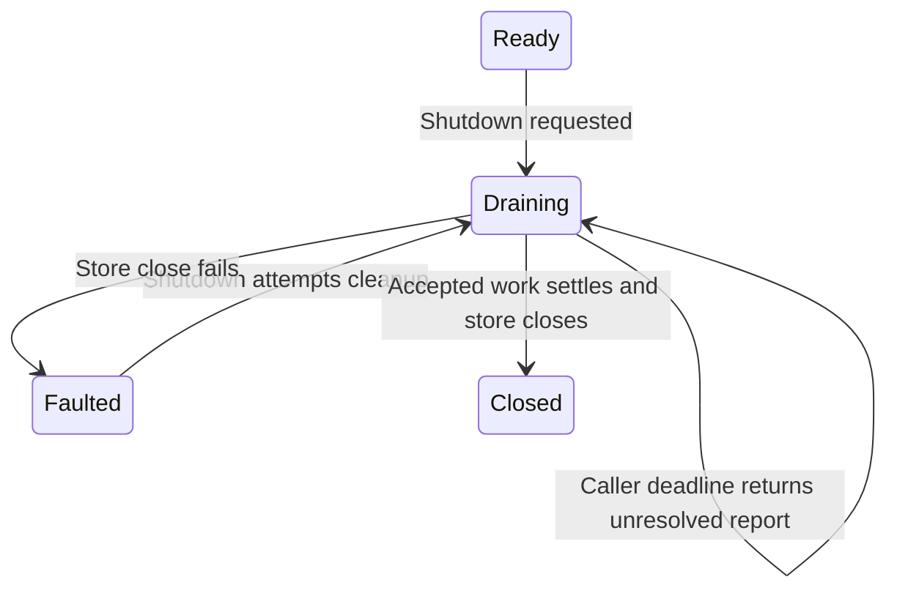

# Stop admission without abandoning accepted operations

Call Runtime.shutdown with a deadline when the host is stopping. It moves to
Draining, rejects new work, ends subscriptions and starts an owned finalizer.
The finalizer continues if the caller cancels or times out its wait. A deadline
bounds the wait; it does not magically stop storage I/O.

## Inspect the report before handing over ownership

A report with closed=false means close did not finish by the deadline. Preserve
unresolved append IDs, lifecycle requests and unfinished cleanup count. The old
owner can still own I/O; do not force-open another writer or delete ownership
files. Continue observing shutdown and reconcile named unknown operations through
the store's contract. Even closed=true may carry unresolved historical outcomes;
closed and every business effect known are different claims.

Dropping a handle or future is not cancellation of an accepted commit. The runtime
retains finite request/buffer/I/O reservations until owned work settles. Capacity
is charged across waiting and in-flight work, not merely visible queue length.
Default limits and diagnostics are policy settings, not qualified population
capacity. This page is source-reviewed; it has no model of scheduler progress,
shutdown timing, deadlocks or filesystem-close guarantees.
