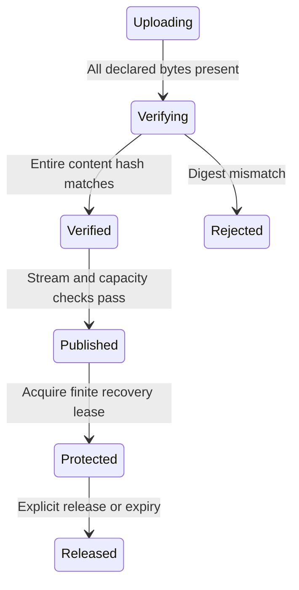

# Recover application state plus a retained suffix

Your application creates snapshot bytes and a descriptor naming the cursor they
cover. For example, a snapshot through 7 represents application state after event 7;
recovery applies records after 7 through the plan's captured tail. The store can
check size/digest and cursor identity, but cannot prove those bytes mean what your
application says they mean.

## Publication and recovery are different steps

Upload bounded chunks under one descriptor, drive bounded verification steps, and
publish only Verified content. Repeating the same publication can return the same
descriptor. A failed or uncertain publication is not evidence that nothing became
visible; preserve the ID/request and query or retry through the owning API.

Acquire recovery before reading snapshot bytes and the protected suffix. Its plan
captures through and holds a finite lease. Read within that boundary, build your
application state, and release protection when finished. Lease expiry means
protection is gone; do not continue assuming cleanup is blocked. Reacquire a valid
plan and reconcile partial application work. Schema compatibility and external
projection installation remain application responsibilities.

SnapshotPublication models two independent uploaded chunks, two verified chunks
and matching/mismatching content digest. It checks publication needs complete
content verification and a matching digest. It excludes cryptographic strength,
serialization meaning, publication capacity and recovery lease timing.
